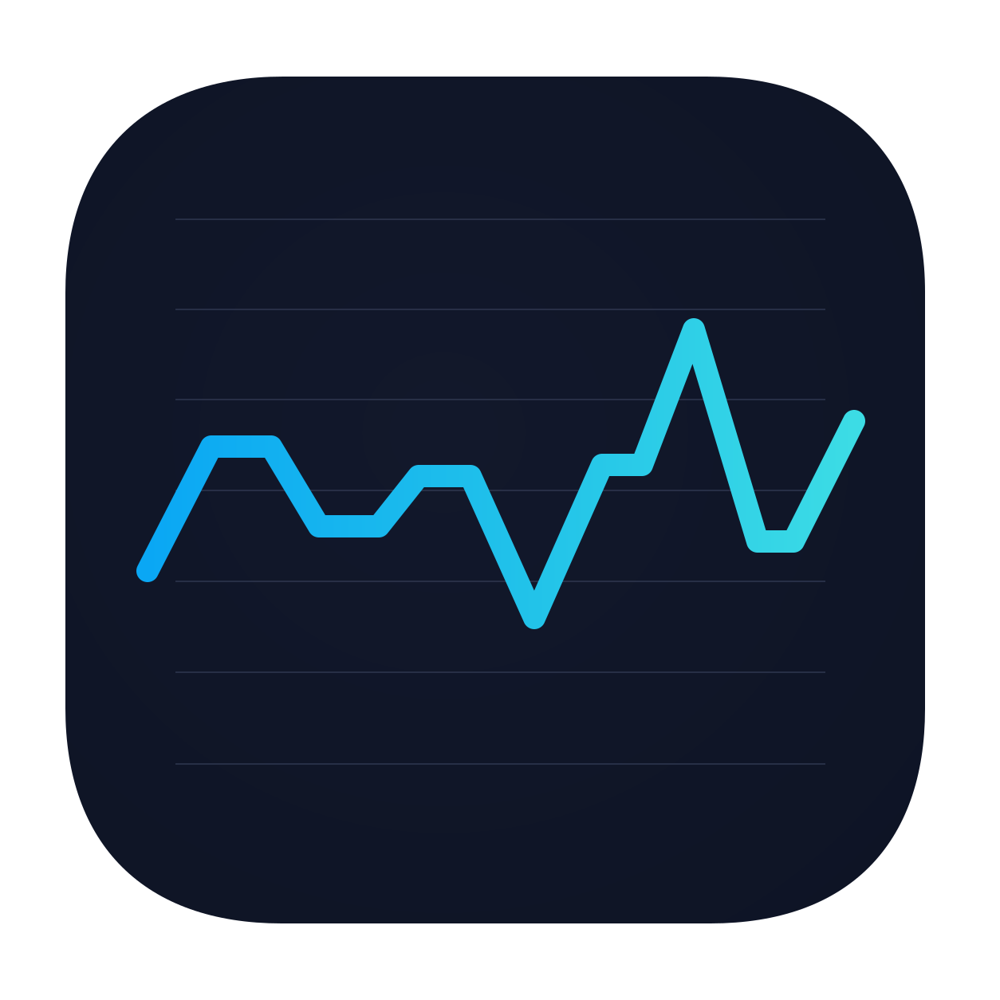
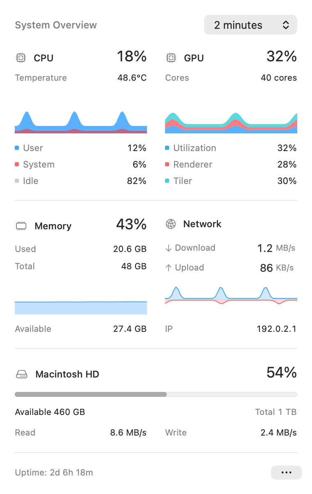

<p align="center"></p>
<h1 align="center">Neylu</h1>
<p align="center"><a href="README.md">简体中文</a> · English</p>
<p align="center">A compact, native system monitor for the macOS menu bar.</p>

[](https://github.com/chenmobuys/Neylu/actions/workflows/ci.yml)
[](https://github.com/chenmobuys/Neylu/releases)
[](LICENSE)


[](https://github.com/chenmobuys/Neylu/stargazers)

<p align="center"><picture>
  <source media="(prefers-color-scheme: dark)" srcset="docs/images/overview-dark-en@2x.png">
  
</picture></p>

The preview uses demonstration readings. Native materials adapt to the system appearance and desktop background.

## Features

- Network, memory, GPU, CPU, and system disk metrics in one menu bar item; choose what to show and reorder it.
- Live charts, CPU temperature on supported hardware, and disk capacity and read/write rates; monitor and eject external drives.
- Native glass on macOS 26+, system materials on earlier releases, and automatic/light/dark appearance.
- English and Simplified Chinese; configurable refresh intervals, decimal or binary units, and energy-saving options.
- Local history retained for 24 hours, with two-minute, fifteen-minute, and one-hour chart views. No telemetry or monitoring-data uploads.
- Built-in update checks, verified installers, and release notes after upgrades.

## Install

Requires **macOS 12 or later**, on Apple Silicon or Intel. Latest downloads are listed in [GitHub Releases](https://github.com/chenmobuys/Neylu/releases).

```sh
brew install --cask chenmobuys/tap/neylu
```

Or download a DMG: choose `arm64` for Apple Silicon or `x86_64` for Intel, open it, and drag **Neylu.app** into **Applications**. Xcode and an Apple Developer membership are not required to use the app.

## First launch

The current Alpha is ad hoc signed and **not notarized by Apple**. If macOS blocks it, follow [Apple’s instructions](https://support.apple.com/102445) to choose **Open Anyway**. If you trust the downloaded Neylu, you can instead run:

```sh
xattr -dr com.apple.quarantine "/Applications/Neylu.app"
```

Use your actual installation path. This affects only Neylu; it does not disable Gatekeeper or SIP. See [update troubleshooting](docs/UPDATING.en.md) if the alert names `NeyluUpdater`.

## Use

- Left-click the menu bar readings to open the overview; right-click, or use **…**, to open settings.
- **Menu Bar Items…** selects and reorders metrics; **Appearance** changes the theme; **Preferences** contains refresh interval, energy saving, units, language, login, and automatic update checks.
- Choose a history range at the top of the overview; hover or use Left/Right Arrow keys to inspect real samples. Press Escape to close details and utility windows.
- Copy diagnostics without IP addresses or paths from the menu or About window. Choose **Check for Updates…**, or update with `brew update && brew upgrade --cask --greedy neylu`.

## Documentation

- [Updating and troubleshooting](docs/UPDATING.en.md)
- [Metrics and hardware compatibility — Chinese](docs/METRICS.md)
- [Build and contribution guide — Chinese](CONTRIBUTING.md)
- [Release automation — Chinese](docs/RELEASING.md)
- [Changelog](CHANGELOG.md) · [Security](SECURITY.md) · [MIT License](LICENSE) · [Attributions](THIRD_PARTY_NOTICES.md)
