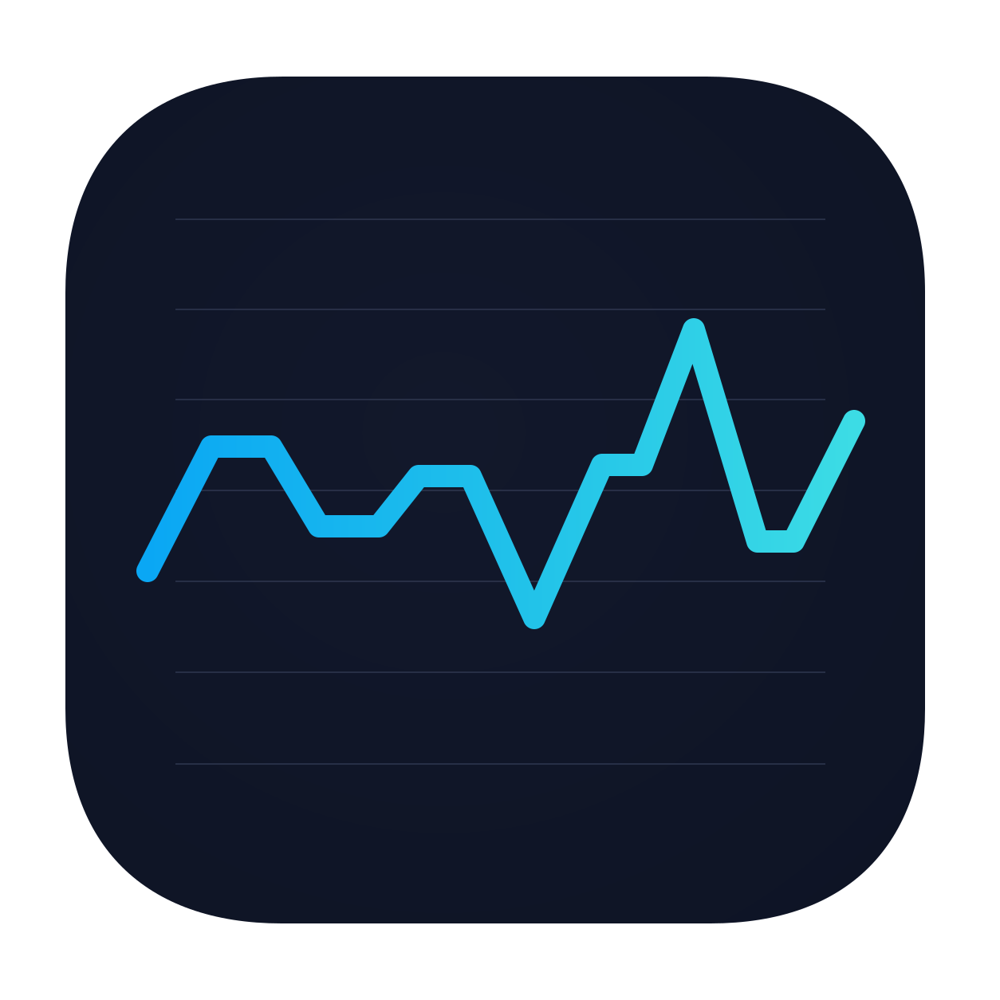
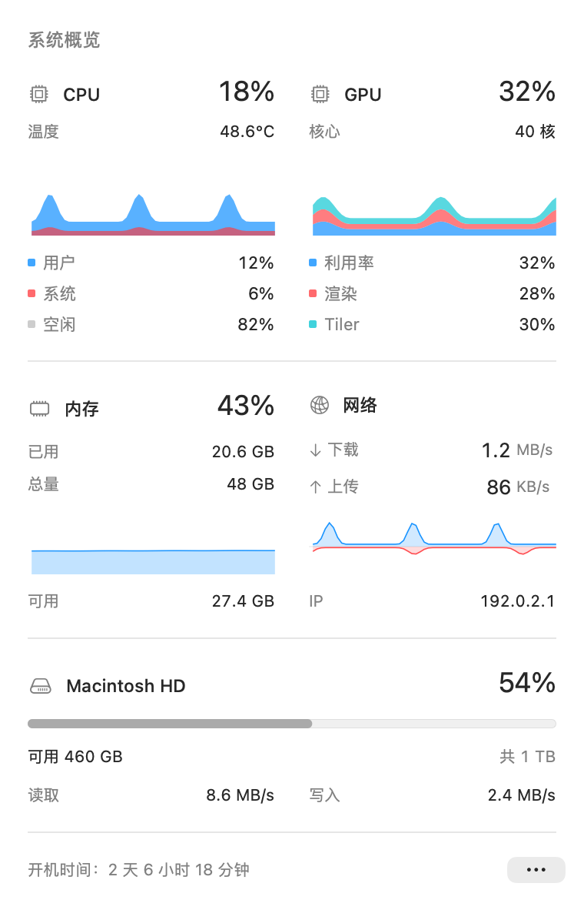
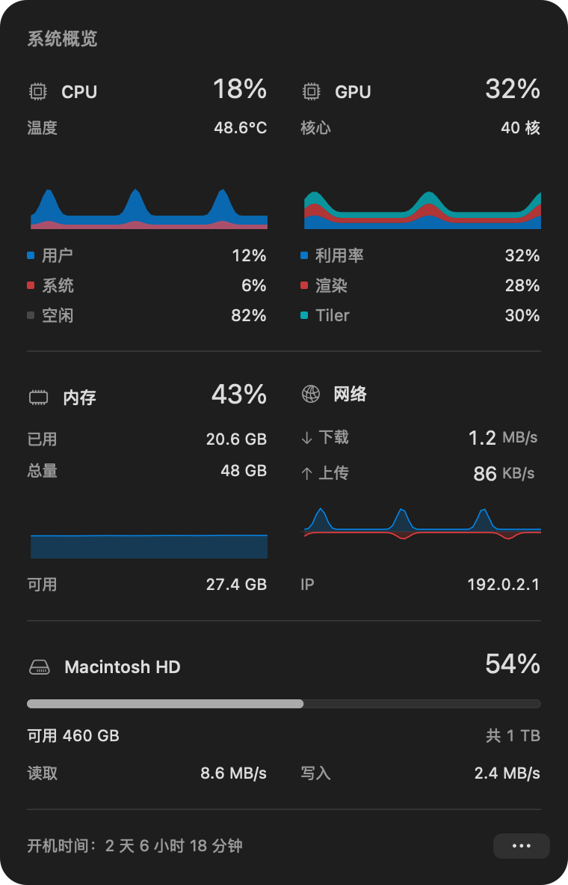

<p align="center"></p>
<h1 align="center">Neylu</h1>
<p align="center">简体中文 · <a href="README.en.md">English</a></p>
<p align="center">安静、紧凑的原生 macOS 菜单栏监控工具。</p>
<p align="center">
  <a href="https://github.com/chenmobuys/Neylu/actions/workflows/ci.yml"></a>
  <a href="https://github.com/chenmobuys/Neylu/releases"></a>
  <a href="LICENSE"></a>
  
  
  
  <a href="https://github.com/chenmobuys/Neylu/stargazers"></a>
</p>

菜单栏默认显示上传、下载、内存、GPU 和 CPU；点击展开 CPU、GPU、内存、网络及磁盘详情。
使用系统字体、原生控件和系统材质，保持一页轻览。

## 界面

<p align="center">
  <picture>
    <source media="(prefers-color-scheme: dark)" srcset="docs/images/menu-dark@4x.png">
    
  </picture>
</p>
<table>
  <tr><th>浅色外观</th><th>深色外观</th></tr>
  <tr>
    <td></td>
    <td></td>
  </tr>
</table>

<sub>使用 App 原生组件渲染的界面预览，采用演示读数与文档专用 IP。文档图使用系统明暗底色；实际运行时的玻璃质感随系统背景变化。</sub>

## 功能

- **一个菜单栏项目**：所有读数作为一个整体，数字等宽，上传下载分别显示完整单位。
- **自定菜单栏**：在「菜单栏显示…」中勾选网速、内存、CPU、GPU 或系统盘占用，并拖动排序；实时预览、自动保存。默认网速 / MEM / GPU / CPU；全部隐藏时保留 Neylu 图标。
- **原生外观**：macOS 26+ 系统玻璃；macOS 12–25 原生材质回退，跟随系统外观。
- **实时图表**：CPU/GPU 并排、内存/网络并排，磁盘显示占用和读写速度。
- **外接磁盘**：自动显示已挂载的 U 盘、移动硬盘和外接 SSD，拔出后移除；名称旁提供系统原生弹出按钮，多磁盘时可滚动查看。
- **本机历史**：SQLite 增量存储 24 小时，打开时恢复最近两分钟；没有遥测，不上传监控数据。
- **多语言**：简体中文与 English，可在设置中即时切换，默认跟随系统。
- **简单设置**：外观（自动 / 浅色 / 深色，默认自动）、刷新间隔（1 / 2 / 5 / 10 秒，默认 2 秒）、十进制/二进制单位、开机启动、活动监视器与关于窗口。

## 安装

当前版本为 **0.1.0-alpha.2**，面向早期测试，功能和兼容性仍在完善。
当前未配置 Apple Developer ID，预发布附件只有 ad-hoc 签名、未经 Apple 公证；macOS 可能阻止直接打开下载的应用。
安装和使用预发布版不需要 Xcode 或 Apple Developer 会员；首次打开可能需要按下方步骤手动允许。

### GitHub Releases

在 [GitHub Releases](https://github.com/chenmobuys/Neylu/releases) 选择预发布版本，按芯片选择 DMG 安装包：

| Mac 芯片 | 安装包 |
| --- | --- |
| Apple Silicon（M 系列） | `Neylu-版本-arm64.dmg` |
| Intel | `Neylu-版本-x86_64.dmg` |

双击 DMG，将 `Neylu.app` 拖到映像内的「Applications」文件夹，然后从「应用程序」打开。

GitHub 会为每个 Release 附件生成 SHA-256 摘要；后续版本只发布 DMG，不再附加独立校验文件。可在附件旁查看摘要，再核对本地计算结果：

```sh
shasum -a 256 Neylu-0.1.0-alpha.2-arm64.dmg
```

### 首次打开被 macOS 拦截怎么办？

当前 Alpha 尚未经 Apple 公证。如果出现“无法验证开发者”或“Apple 无法检查是否包含恶意软件”等提示，请先确认安装包来自[本仓库 Releases](https://github.com/chenmobuys/Neylu/releases)，并确认你信任这个版本。

**方式一：通过系统设置允许打开（推荐，无需终端）**

1. 将 `Neylu.app` 拖入「应用程序」，并尝试打开一次。
2. 打开「系统设置 → 隐私与安全性」，在安全性区域找到 Neylu 的拦截提示，点击「仍要打开」。
3. 按系统提示确认并点击「打开」。之后通常可以直接打开。

详见 [Apple 官方说明](https://support.apple.com/zh-cn/102445)。由组织管理的 Mac 可能不允许自行添加例外，需要联系管理员。

**方式二：手动移除 Neylu 的下载隔离标记**

确认 App 已放入「应用程序」后，打开「终端」，执行：

```sh
xattr -dr com.apple.quarantine "/Applications/Neylu.app"
```

然后从「应用程序」双击 Neylu。此命令只针对这个 App 的下载隔离标记，不会关闭系统 Gatekeeper 或 SIP；它不能替代 Apple 签名、公证，也不能修复签名损坏、架构不兼容或应用自身的问题。重新下载或更新后，可能需要再次允许打开。

如果看到“将损坏你的电脑”等恶意软件警告，不要用上述命令处理。若仍无法打开，重新下载对应芯片的安装包并核对校验和；仍有问题时，请在 [Issues](https://github.com/chenmobuys/Neylu/issues) 附上 macOS 版本、芯片类型、Neylu 版本及完整报错文字。

### 怎么使用

- **找到 Neylu**：启动后显示在屏幕顶部菜单栏，默认不在 Dock 显示，也不会弹出主窗口。
- **快速查看**：菜单栏显示上传、下载速度和 MEM / GPU / CPU 占用。点击读数，展开 CPU、GPU、内存、网络和磁盘详情。
- **调整设置**：点击详情右下角的「…」，调整外观、刷新间隔、单位进位和开机启动。也可切换语言和配置菜单栏显示。
- **右键菜单**：右键点击菜单栏读数，直接打开同一套设置菜单；左键仍用于打开或收起详情。
- **收起详情**：再次点击菜单栏读数、按 Esc，或切换到其他 App。
- **安全弹出外接磁盘**：点击磁盘名称旁的弹出图标，等待系统完成后再拔出。被占用等情况会显示系统错误，不强制卸载。
- **退出应用**：在「…」菜单中选择「退出」。

### 检查与安装更新

通过静态 appcast 检查版本，安装包仍由 GitHub Releases 提供；客户端不调用 GitHub REST API，也不需要登录或 Token。手动和后台检查共用一分钟内的缓存及进行中的请求。默认每天后台检查一次；有新版时在详情设置按钮显示提示点，菜单显示版本号，不自动弹窗或下载安装。可关闭「自动检查更新」。图表支持悬浮或聚焦后按左右方向键查看实际采样，四项指标共用时间指示线；Escape 关闭详情和工具窗口。

在详情「…」或菜单栏右键菜单选择 **检查更新…**。发现适合当前架构的新版本后，点击 **立即更新**，Neylu 会下载 GitHub Releases 的 DMG，核对 GitHub 提供的 SHA-256 摘要、应用版本、架构及代码签名，再正常退出、替换并重启。历史记录与偏好设置保存在 App 外，会继续保留。替换、系统启动请求失败，或新版在启动后的短暂观察期内退出时，恢复原应用。

- Alpha / Beta / RC 版本会检查后续测试版和正式版；正式版只接收正式更新，不降级。
- 检查由用户手动发起；不上传监控数据，不需要 GitHub 登录。网络不可用或 GitHub 限流时可重试，或从窗口打开发布页下载。
- 如果正在 DMG 中运行、处于 App Translocation 隔离位置或安装目录不可写，改为打开已校验的安装包，手动拖入「应用程序」，不会自动请求提权。
- 当前 Alpha 仍未完成 Developer ID 签名与公证。更新不会关闭 Gatekeeper 或移除隔离标记；系统仍有可能要求按上面的首次打开步骤允许新版运行。SHA-256 用于发现下载损坏，不替代开发者身份认证，更新源依赖本仓库的 GitHub HTTPS 发布渠道。

也可先退出 Neylu，再手动将新版 `Neylu.app` 拖入「应用程序」替换旧版。

### Homebrew

通过独立的 [homebrew-tap](https://github.com/chenmobuys/homebrew-tap) 安装；自动选择 Apple Silicon 或 Intel 安装包。目前提供 Alpha 测试版，未经 Apple 公证，首次打开仍需按上面的说明允许运行，不需要开发者会员。

```sh
brew install --cask chenmobuys/tap/neylu
```

安装完成后，Homebrew 会直接打印首次打开说明和 `xattr` 命令。若 macOS 拦截启动，确认信任此版本后执行，再重新打开 Neylu：

```sh
xattr -dr com.apple.quarantine "/Applications/Neylu.app"
```

也可以一次复制以下命令，安装成功后由你主动允许首次打开（默认安装到「应用程序」）：

```sh
brew install --cask chenmobuys/tap/neylu &&
xattr -dr com.apple.quarantine "/Applications/Neylu.app"
```

这只移除 Neylu 的下载隔离标记；也可通过「系统设置 → 隐私与安全性 → 仍要打开」允许启动。若使用了 `--appdir`，请将路径改为实际安装位置；安装后的提示会使用所选路径。

完整名称依次为「账号 / tap / 软件名」。Homebrew 6+ 首次安装会据此信任这一项 Cask；安装后可简写为 `brew install --cask neylu`。
升级：`brew update && brew upgrade --cask --greedy neylu`。`--greedy` 用于包含内置更新功能的 App。
普通卸载保留历史与偏好：`brew uninstall --cask neylu`。
`brew uninstall --cask --zap neylu` 会额外删除 Neylu 历史和偏好，请按需使用。

发布成功后会自动校验并更新 tap，无需手动合并安装定义。

自有 tap 不等于 Homebrew 官方仓库收录；每个安装包均使用真实 SHA-256 校验，不自动移除隔离标记。

## 系统要求与读数

| 项目 | 支持情况 |
| --- | --- |
| 运行 | Apple Silicon 或 Intel、macOS 12+（开发分支；已发布至 alpha.4 的安装包仍要求 13+） |
| 源码构建 | Xcode 26+，需要 macOS 26+ SDK |
| CPU / 内存 / 网络 | 按所选刷新间隔采样，默认 2 秒；网络自动使用主接口 |
| CPU 温度 | 按 Intel、Apple M1–M5 区分已知传感器；未知型号显示不支持，读取失败显示不可用。当前实际验证设备为 M3 Max，其他型号仍需硬件回归 |
| GPU | 依赖 IOKit 提供利用率、渲染、Tiler 与核心数；缺失指标显示为破折号并以空值保存，真实 0 保留为 0 |
| 磁盘 | 系统盘和已挂载外接磁盘的容量；读写速度来自各卷所在物理磁盘，不显示未采集的温度 |

图表空档会连接前后真实采样点，连接仅用于视觉展示，不补写停采数据。
内存占用按 App、联动与压缩内存统计，不把可回收文件缓存计入使用量。
GPU 指标完整时三个值各按 1/3 堆叠，总高度表示平均值；仅堆叠整个可见历史中完整可用的指标，缺失项不补零。图例显示原始百分比，不能视为三种互斥负载之和。

系统采样在后台串行执行，刷新请求合并处理，界面仅在主线程接收结果；睡眠前的旧结果不会覆盖唤醒后的读数。
更多指标定义见 [技术说明](docs/METRICS.md)。

## 隐私与历史

默认每天在后台检查一次 GitHub 更新，可在设置菜单关闭；手动检查、安装更新及打开项目链接时也会访问 GitHub。不收集遥测、不上传监控数据、不读取进程内容、不要求管理员权限。
CPU/GPU/内存/网络历史保存在 `~/Library/Application Support/Neylu/history.sqlite`，保留 24 小时。目录仅当前用户可访问，数据库及 WAL 文件权限为 0600。
每 30 秒批量写入，退出和睡眠前保存；强制结束或断电最多可能丢失约 30 秒加一次采样间隔的未写入记录。
开机时间来自内核 `kern.boottime`，包括睡眠。

应用标识为 `io.github.chenmobuys.Neylu`，历史数据与偏好设置均使用 Neylu 自身的路径。

## 开发

```sh
./build.sh
open build/Neylu.app
./test-history.sh
./test-updates.sh
./test-performance.sh # 可选：本机采样与离屏渲染基准，不代表整机能耗
python3 -m unittest discover -s Tests -p 'test_*.py' -v
./test-runtime.sh
```

输出位于 `build/`，缓存位于 `.build/`，均不会提交。
使用系统框架与 SQLite，无第三方运行时依赖。
默认图标源是 [纯矢量 SVG](Assets/AppIcon-v5-vector.svg)，构建时直接渲染所有尺寸。

## 发布与贡献

- [更新记录](CHANGELOG.md)
- [发布与 GitHub / Homebrew 配置](docs/RELEASING.md)
- [贡献指南](CONTRIBUTING.md)
- [安全反馈](SECURITY.md)
- [第三方致谢](THIRD_PARTY_NOTICES.md)

## 许可

Neylu 使用 [MIT License](LICENSE)。第三方参考材料的许可保留在 THIRD_PARTY_NOTICES.md 中。
